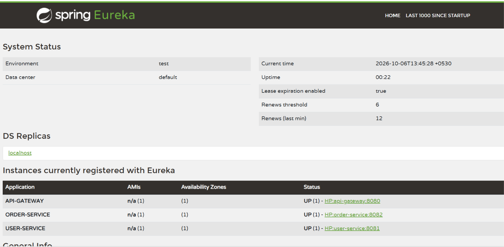
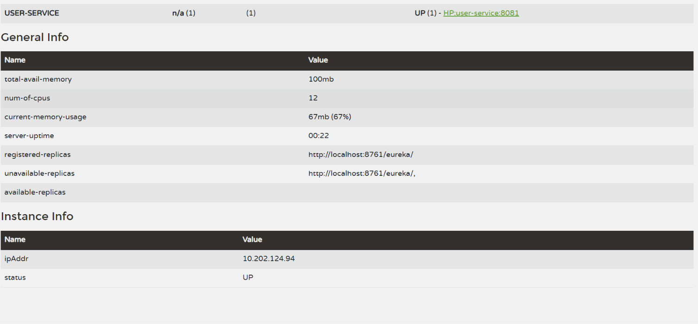
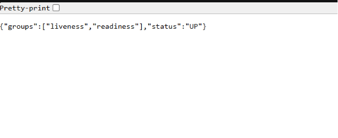

# E-commerce Microservices

A Spring Boot microservices demo with an API Gateway, Eureka service discovery, a Config Server, a User Service, and an Order Service.

## Requirements

- Java 25
- Maven 3.9+

## Build and test

From the repository root, build either reactor:

```powershell
mvn -f .\api-gateway\pom.xml clean verify
mvn -f .\microservices-demo\pom.xml clean verify
```

## Run locally

Start the services from the `microservices-demo` directory in this order:

1. `config-server`
2. `discovery-server`
3. `user-service` and `order-service`
4. `api-gateway`

For each service, run `mvn spring-boot:run` from its module directory in a separate terminal.

| Service | Local URL |
| --- | --- |
| API Gateway | <http://localhost:8080> |
| User Service health | <http://localhost:8081/actuator/health> |
| Order Service health | <http://localhost:8082/actuator/health> |
| Config Server health | <http://localhost:8888/actuator/health> |
| Eureka dashboard | <http://localhost:8761> |
| API Gateway health | <http://localhost:8080/actuator/health> |

The API Gateway currently has no homepage or business routes, so its root URL returns HTTP 404. The health endpoints report service health, and Eureka displays registered service instances.

## Sample output

Eureka dashboard showing the gateway and services registered as `UP`:



Additional Eureka instance and system details:



Actuator health response:


